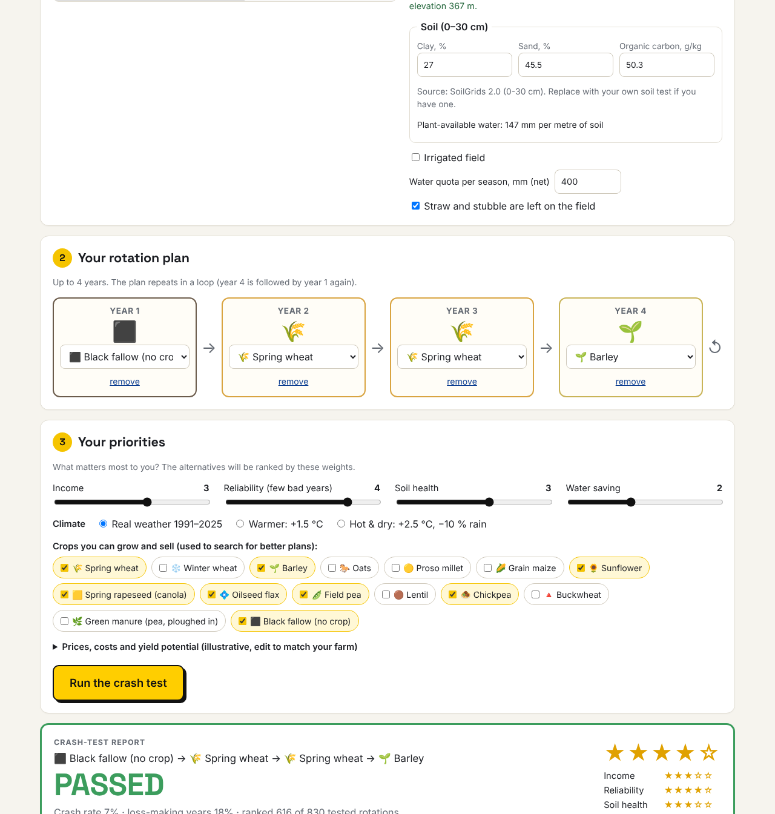

# 🌾 Crop Rotation Crash Test

**NASA Space Apps Challenge 2026 · Challenge: “Field Shift: Adapting Farms with NASA Data”**
Team of 9th-grade students from Astana, Kazakhstan 🇰🇿

> Test your crop rotation against 34 years of real NASA weather, before the weather tests it for you.

*Русская версия ниже ↓*



## What it does

Car makers crash-test a car before anyone drives it. We do the same for a farmer's crop rotation.

1. **Your farm.** Click your field on the map. The app downloads 35 years (1991–2025) of daily NASA POWER weather for that exact point. It also downloads the soil (texture, organic carbon) from ISRIC SoilGrids, and you can replace that with your own soil test. You can also mark the field as irrigated, set a water quota, and say whether straw is left on the field.
2. **Your plan.** Enter your rotation: 1–4 crops, repeated in a loop. There are 15 options, including spring and winter wheat, barley, pulses, oilseeds, black fallow and green manure.
3. **Your priorities.** Set sliders for income, reliability, soil health and water saving. Pick a climate (real weather, +1.5 °C, or +2.5 °C with −10 % rain) and tick the crops you can actually grow and sell.
4. **Crash test.** The app drives the plan, day by day, through every real season at your field. It starts the plan from every position, so every crop meets every year. You get:
   - a **verdict** (PASSED / DAMAGED / CRASHED) with star ratings for income, reliability, soil and water;
   - a **crash map** showing every crop × every year, with the cause of each failure (drought, heat at flowering, frost, winter-kill, not ripening, too-short rotation);
   - the **smallest change** to your plan that helps the most, for your priorities;
   - the **best rotations** out of ~800 tested automatically;
   - a **climate stress test**: how your plan and the best plan behave in a warmer and drier future;
   - charts of income, the soil-carbon trend, the farm's climate fingerprint, and a check of our model against NASA's own soil-moisture product;
   - a printable report and a season-by-season CSV.

## NASA data

| Data | What we use it for |
|---|---|
| **NASA POWER** daily point API (Agroclimatology), 1991–2025: `T2M_MAX`, `T2M_MIN`, `PRECTOTCORR`, `ALLSKY_SFC_SW_DWN`, `RH2M`, `WS2M` (from MERRA-2, CERES/GEWEX) | Drives everything: Penman-Monteith evapotranspiration, the soil water balance, snow, crop development, heat/frost events, and erosion-risk days (strong wind, downpours) |
| **MERRA-2 root-zone soil wetness** `GWETROOT` (via POWER) | Independent validation of our soil-water model. Monthly anomaly correlation is r ≈ 0.6–0.8 at the Kazakhstan sites |
| ISRIC **SoilGrids 2.0** (non-NASA, open) | Clay, sand, organic carbon and bulk density at 0–30 cm. These give plant-available water and the starting soil carbon |

## How the model works (short)

A transparent, daily, process-light model in plain JavaScript (`js/model.js`):

- **ET₀:** FAO-56 Penman-Monteith from the POWER variables.
- **Soil water:** a two-layer bucket 1.8 m deep. Available water comes from Saxton & Rawls (2006) pedotransfer functions. Runoff uses the SCS curve number, bare-soil evaporation follows FAO-56 (two stages), and snow is trapped by stubble and melted by degree-days.
- **Crops:** climate-driven sowing windows (they work anywhere, including the southern hemisphere), growing-degree-day phenology, and FAO-56 Kc and Ks. Yield follows the FAO-33 response to water (Ky) and is reduced for heat at flowering, frost, winter-kill under thin snow, not ripening before the autumn frost, and disease when a crop returns too soon.
- **Rotation effects:** nitrogen credit from legumes, green manure and fallow; a break-crop bonus; a cereal-after-cereal penalty.
- **Soil carbon:** a simplified ICBM-type balance. Humified residues and roots are weighed against decomposition driven by temperature and moisture.
- **Soil health score:** the carbon trend plus the 4 USDA-NRCS soil health principles (keep soil covered, keep living roots, maximise diversity, minimise disturbance).
- **Crash** = a season that loses more than half of the money put into the field. **Dent** = a loss-making season.
- **Optimiser:** all distinct cyclic rotations of 1–4 crops from the farmer's crop list, plus every one-edit variant of the farmer's plan. They are scored by min-max-normalised pillars weighted by the farmer's sliders.

Full description and honest limitations: open “How it works & data sources” at the bottom of the app.

## Run it

It is a static site with no build step and no server code.

```bash
python3 -m http.server 8000
```

Then open http://localhost:8000. Opening `index.html` directly also works.

- The six example farms (`data/presets/*.js`) contain real NASA POWER and SoilGrids data, so the demo works offline. To regenerate them, run `python3 tools/build_presets.py`.
- Any other location is downloaded live from NASA POWER in the browser (CORS is open), which takes about 5–10 s.
- Tests: `npm test` (Node ≥ 18, no dependencies).

## Project structure

```
index.html            UI (English / Russian)
css/style.css
js/model.js           simulation, crash test, scoring, optimiser, validation
js/crops.js           crop parameter database (FAO-56 / FAO-33 based, editable prices)
js/app.js             UI controller, NASA POWER & SoilGrids loading, rendering
js/charts.js          tiny SVG charts
js/i18n.js            EN / RU strings
data/presets/         real NASA POWER + SoilGrids data for 6 example farms
tools/build_presets.py
tests/                Node tests (FAO-56 ET0 example, yield sanity, NASA GWETROOT agreement…)
vendor/leaflet/       map library (BSD-2-Clause)
```

## Limitations

This is a screening and decision-support tool, not a calibrated crop model.
- Yield potentials, prices and costs are rough illustrative numbers. Farmers should edit them; there is a table in the app.
- POWER weather is a ~0.5° grid average and can miss local showers and hail.
- Pests, weeds and fertiliser are represented only by simple rotation rules.
- SoilGrids often overestimates organic carbon in steppe soils. Use a lab soil test when possible.

## Use of AI

AI assistance (Claude by Anthropic) was used to help write and debug the code and the texts. The idea, the choice of crops and the priorities came from the team, and the team checked the results against published Kazakhstan yields and agronomy rules. No AI-generated images, video or audio are presented as NASA data.

## Credits & licence

- Weather: NASA POWER Project, NASA Langley Research Center (power.larc.nasa.gov). NASA does not endorse this project.
- Soil: ISRIC SoilGrids 2.0 (CC-BY 4.0).
- Map: Leaflet, © OpenStreetMap contributors.
- Methods: FAO Irrigation & Drainage Papers 33 & 56; Saxton & Rawls (2006); Andrén & Kätterer (1997) ICBM; USDA-NRCS soil health principles.
- Code: MIT licence (see `LICENSE`).

---

# 🌾 Краш-тест севооборота (RU)

**NASA Space Apps Challenge 2026 · челлендж «Field Shift: Adapting Farms with NASA Data»** · команда девятиклассников из Астаны.

Автопроизводители проводят краш-тест машины до того, как на ней кто-то поедет. Мы делаем то же самое с севооборотом фермера.

1. **Хозяйство.** Кликаете своё поле на карте. Сервис скачивает 35 лет (1991–2025) ежедневной погоды NASA POWER для этой точки и почву из SoilGrids (её можно заменить своим анализом). Можно также указать орошение с лимитом воды и оставляете ли вы солому на поле.
2. **План.** Вводите свой севооборот из 1–4 культур, он повторяется по кругу.
3. **Приоритеты.** Выставляете ползунки: доход, надёжность, почва, вода. Выбираете климатический сценарий и отмечаете культуры, которые реально можете выращивать и продавать.
4. **Краш-тест.** План день за днём прогоняется через каждый реальный сезон на вашем поле. Результат:
   - вердикт (ПРОЙДЕН / ЕСТЬ ПОВРЕЖДЕНИЯ / АВАРИЯ) со звёздами;
   - карта аварий «культура × год» с причинами;
   - **самое маленькое изменение плана**, которое даёт наибольшую пользу;
   - лучшие севообороты из ~800 проверенных;
   - климатический стресс-тест;
   - проверка модели по спутниковой влажности почвы NASA (GWETROOT);
   - отчёт для печати и CSV.

**Запуск:** выполните `python3 -m http.server 8000` и откройте http://localhost:8000, либо просто откройте `index.html`. Тесты: `npm test`.
